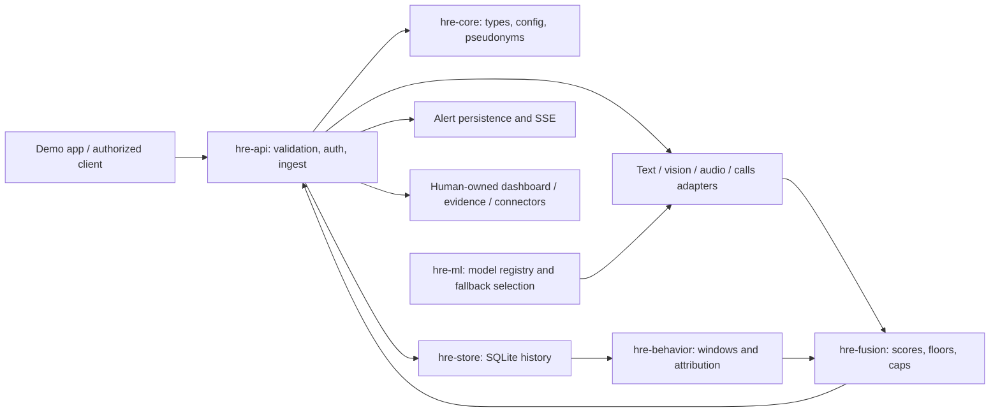

# Architecture

Snapshot: 2026-10-28. This is the target design from ENGINE_PROMPT.md, not a verified deployment diagram. Parent reports P0 scaffold/configuration/contract/mock work in progress. Build and network verification are unresolved; no build was run by this documentation sidecar.

## Boundaries

| Owner | Modules | Integration rule |
|---|---|---|
| Lead | hre-core/store/ml/behavior/fusion/api | Implement walking skeleton and fallback adapters here |
| A | hre-text/slang/eval; training | Pending human implementation and delivery evidence |
| B | hre-vision/audio/calls | Pending human implementation and delivery evidence |
| C | hre-evidence/dashboard/connectors/cli | Pending human implementation and delivery evidence |

## Request flow

Validate and authenticate, scope/pseudonymize identifiers, check event idempotency, persist accepted non-draft input, run applicable modality pipelines, query directional windows, fuse, persist review-or-higher alerts, publish and return. The persist-before-score target needs failure recovery: an interrupted event must not become a permanently cached successful result. Same-ID replay must not increment counters twice. Same ID with different content needs a defined conflict response.

Drafts may read history but must not write events, alerts, pair state, evidence, persistent caches or streams. No fallback may silently invent OCR or ASR output. Return explicit missing/degraded signals and partial results.

## Behavioral and fusion rules

Message windows are 1h/24h/7d per sender→recipient. Calls share directional pair context but have distinct features. Counts, reciprocity, refusal attempts, night timing, gap statistics and escalation support the lead rules fallback; trained behavior requires model artifacts and golden-vector parity later. Recipient-local night defaults to 22:00–05:00 Asia/Kolkata. Treat out-of-order events and missing timezone/context deliberately.

Attribution is occlusion: replace each feature with its benign baseline and measure probability delta. It is not exact SHAP or a causal explanation. Offline SHAP belongs to training.

Fusion target is 100 × (1 − product(1 − weight × score)). Required floors: threat >=0.9→86; sextortion/hash-match/intimate-deepfake composite→86; non-contact unsolicited explicit media→61; post-block→61 (>=3 attempts→75); toxic doxxing→70; address+threat→86. Tone contributes at most +10 and never triggers alone. Reciprocal benign cap is 55 under specified conditions, but S7 must separately stay low; a cap at 55 alone is insufficient. Threats must not be suppressed by a benign-history discount. Floor/cap ordering and C6 victim-reply protection need explicit tests.

## Runtime and resilience targets

| Path | CPU-laptop p95 budget | Current evidence |
|---|---|---|
| Fast text | <=80 ms | Unmeasured |
| Ambiguous text escalation | <=400 ms | Unmeasured |
| Image | <=400 ms | Unmeasured |
| Audio <=15s | <=4s | Unmeasured |
| Behavior + fusion | <=10 ms | Unmeasured |

Use bounded modality concurrency, request deadlines, CPU inference outside async workers, warm sessions and model/content-hash caches. Async recordings should return 202 and job ID; streaming prepared audio is a simulation. Exact retries, queue limits and job persistence are unresolved implementation details.

The prompt requests ONNX centrally but also Whisper ggml through a native backend. Record that exception explicitly; do not describe ggml inference as ONNX. Real registry sessions, tokenization and hot reload remain unverified.

## Contract and operations

Generated docs/openapi.json is the intended machine contract; docs/API.md, docs/FEATURES.md and docs/RUNBOOK.md are lead-owned companion documents outside this sidecar scope. Their presence/finality is not certified here. Proposed endpoints are listed in TRACEABILITY. Required logged recipes and Luna verification belong to the parent; no executable command in this design is evidence of a passing service.
